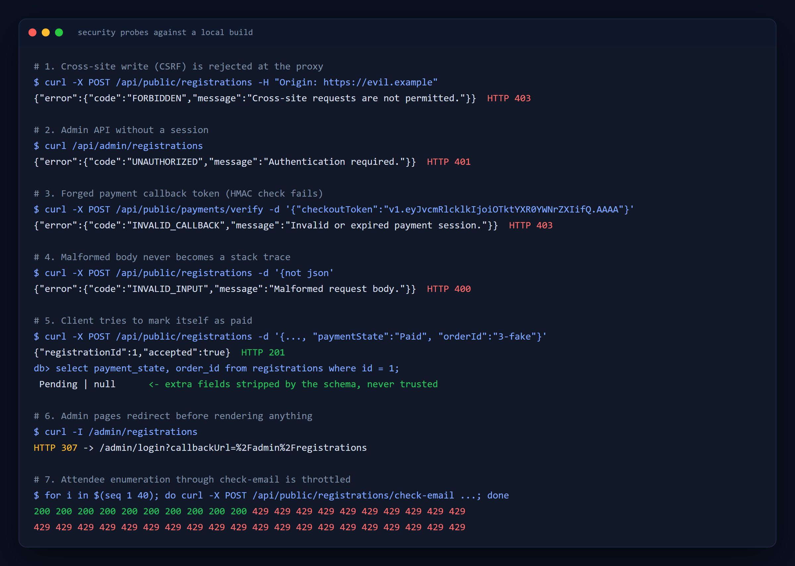
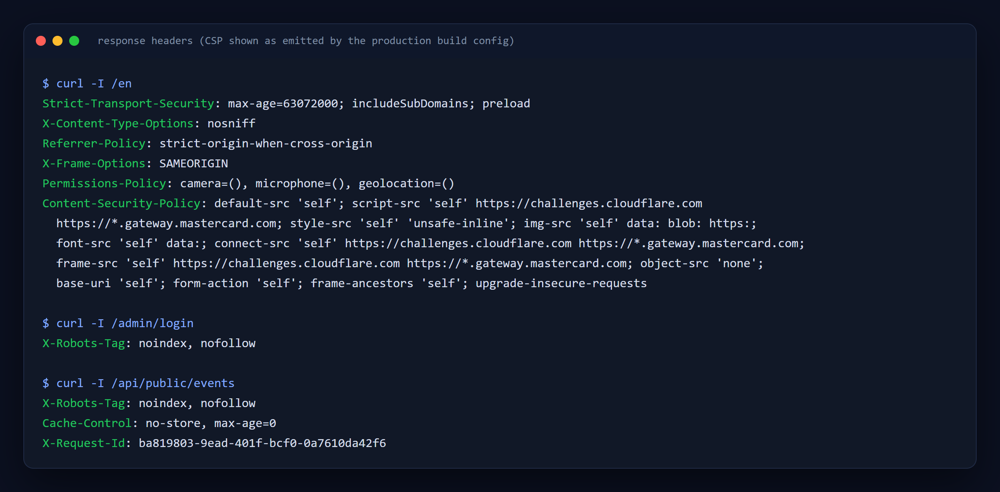
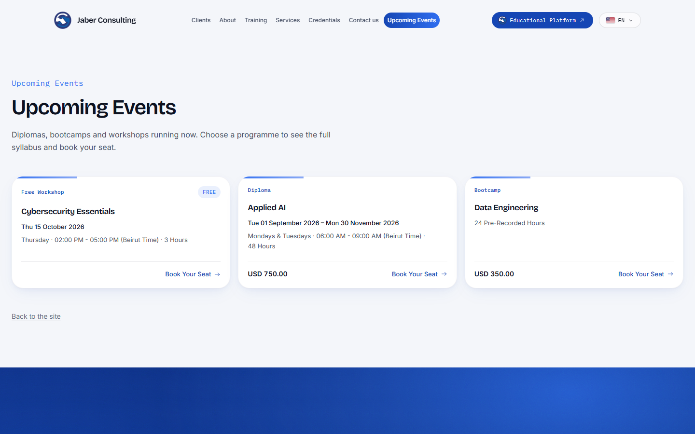
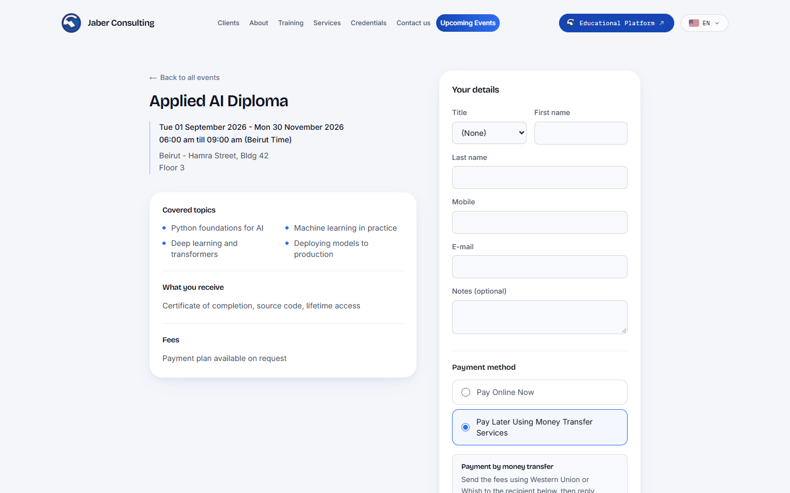
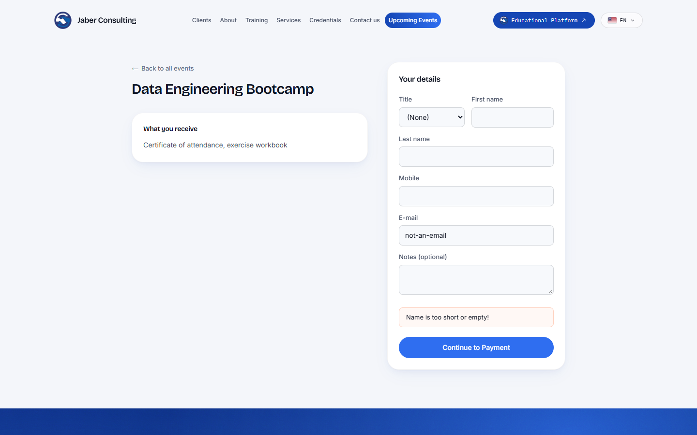
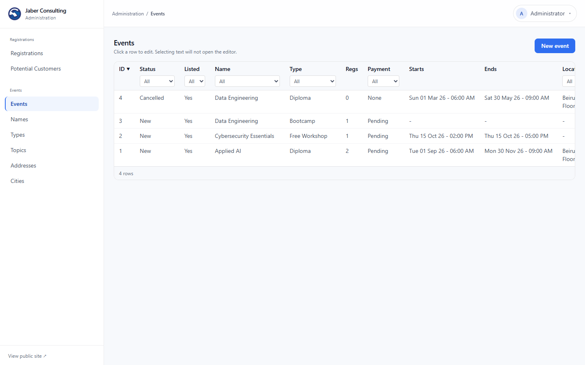
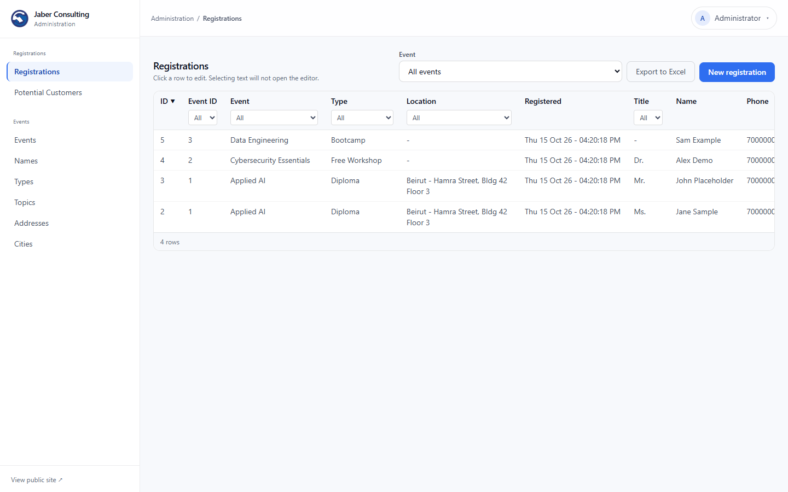
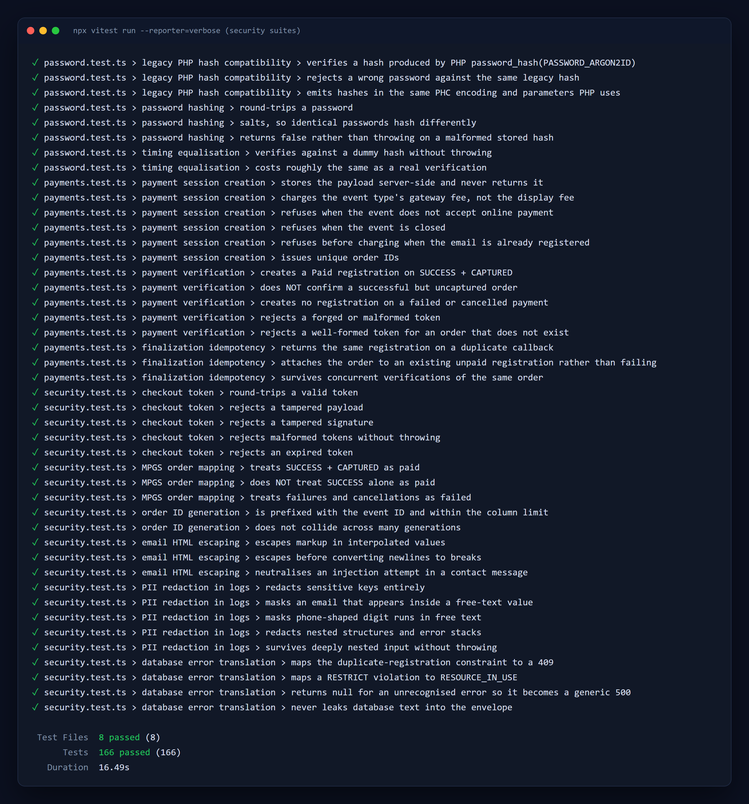

# Jaber Consulting Platform: Secure Legacy Rewrite

A full stack rewrite of a consulting and training firm's legacy PHP website into a
single, security first Next.js application: a trilingual marketing site, an event
registration funnel with online card payments, and a private admin dashboard.

> **This is a showcase repository.** The production codebase is private. What you
> find here is a curated set of real source files from the project, focused on the
> security engineering, plus screenshots and documentation. The samples are
> excerpts, so they will not build on their own.

**Next.js 16** · **React 19** · **TypeScript (strict)** · **PostgreSQL** · **Drizzle ORM**
· **Auth.js** · **Argon2id** · **Zod** · **Tailwind CSS 4** · **Vitest**


---

## Contents

- [The project in one paragraph](#the-project-in-one-paragraph)
- [Features](#features)
- [Security engineering](#security-engineering)
- [Security evidence](#security-evidence)
- [Screenshots](#screenshots)
- [Code samples](#code-samples)
- [Architecture](#architecture)
- [Testing](#testing)

---

## The project in one paragraph

The client's old site was a PHP application that had grown by accretion. It handled
real customer data and real card payments, and it did so with patterns that do not
survive a security review: payment outcomes decided in browser JavaScript, auth
guards repeated by hand on each page, raw database errors rendered into HTML, and
user supplied HTML interpolated straight into outgoing email. I rebuilt it from
scratch as one TypeScript application where each of those weaknesses is closed
**structurally**, meaning the safe behaviour is the default path and the unsafe one
is hard or impossible to write, and every control is pinned by an automated test.

---

## Features

### Public website
- Marketing site in **English, French and Arabic**, with full right to left layout for
  Arabic built on CSS logical properties rather than a mirrored stylesheet
- Locale lives in the URL (`/en`, `/fr`, `/ar`) with `Accept-Language` negotiation
  and a remembered preference
- Per page metadata, canonical URLs, full `hreflang` sets, a generated sitemap and
  generated social share cards
- Indexing is opt in via an environment flag, so a staging copy can never be
  indexed by accident

### Event registration and payments
- Public events list, registration form with live validation, and duplicate email
  detection
- **Online card payment through Mastercard Payment Gateway Services (hosted
  checkout)**, or manual transfer instructions where the event allows it
- Card details never touch the server; payment outcome is verified server to
  server with the gateway
- Abandoned registration capture ("potential customers") via `sendBeacon`
- Asynchronous confirmation emails that can never fail an HTTP request

### Admin dashboard
- Credentials sign in with Argon2id hashes and 8 hour signed JWT sessions
- Events, registrations, event types, names, topics, cities, addresses and leads
- Filterable, sortable data grids that remember their filters
- One click **Excel export** with full event context on every row
- Password change with server enforced rules and forced re-authentication

---

## Security engineering

The full write up, including a threat model and the reasoning behind each decision,
is in **[SECURITY.md](SECURITY.md)**. The short version:

| Area | Control | Where |
|---|---|---|
| Passwords | **Argon2id** (64 MiB, t=4), PHC strings compatible with the legacy PHP hashes so no reset was needed at cutover | [`password.ts`](samples/src/lib/server/auth/password.ts) |
| User enumeration | Unknown emails still pay the full Argon2 cost against a dummy hash, so timing does not reveal which accounts exist | [`password.ts`](samples/src/lib/server/auth/password.ts), [`config.ts`](samples/src/lib/server/auth/config.ts) |
| Sessions | Signed, `HttpOnly`, `Secure`, `SameSite` cookies; role derived from the database at sign in, never from input | [`config.ts`](samples/src/lib/server/auth/config.ts) |
| Authorization | Defense in depth: a proxy guard on the whole `/admin` subtree **plus** an explicit `requireAdmin()` in every route and Server Action | [`proxy.ts`](samples/src/proxy.ts), [`guards.ts`](samples/src/lib/server/auth/guards.ts) |
| CSRF | `Origin` check on every state changing request in the proxy, on top of `SameSite` cookies | [`proxy.ts`](samples/src/proxy.ts) |
| Payment integrity | Payload stored server side before the gateway is called; callback carries only an **HMAC signed, expiring token**; outcome fetched from the gateway API; success requires `SUCCESS` **and** `CAPTURED` | [`payment-service.ts`](samples/src/lib/server/services/payment-service.ts), [`checkout-token.ts`](samples/src/lib/server/integrations/checkout-token.ts), [`mpgs.ts`](samples/src/lib/server/integrations/mpgs.ts) |
| Idempotency | Finalization runs in one transaction with a three step lookup, so duplicate callbacks and races converge on one registration | [`payment-service.ts`](samples/src/lib/server/services/payment-service.ts) |
| Mass assignment | Public schemas do not accept `orderId` or `paymentState`; extra fields are stripped, so a client cannot mark itself paid | [`public.ts`](samples/src/lib/shared/schemas/public.ts) |
| Rate limiting | Sliding window limits (Upstash Redis) on login, contact, payment and the email check oracle; fails open only where safe | [`ratelimit.ts`](samples/src/lib/server/ratelimit.ts) |
| Bot protection | Cloudflare Turnstile, **fails closed**, with hostname binding to stop token replay from another site | [`turnstile.ts`](samples/src/lib/server/integrations/turnstile.ts) |
| Error handling | Every handler is wrapped, so only a fixed error envelope ever leaves the server. Database errors are mapped by constraint name, never by echoing driver text | [`http.ts`](samples/src/lib/server/http.ts), [`errors.ts`](samples/src/lib/shared/errors.ts), [`repositories/errors.ts`](samples/src/lib/server/repositories/errors.ts) |
| Logging | Structural PII redaction: sensitive keys removed, emails masked, phone numbers scrubbed, even inside error stacks | [`logger.ts`](samples/src/lib/server/logger.ts) |
| HTML injection | All interpolated email content is escaped; email bodies are never accepted from the client | [`security.test.ts`](samples/tests/unit/security.test.ts) |
| Headers | Strict CSP (no `unsafe-inline` scripts in production), HSTS with preload, `nosniff`, frame and permissions policies, `noindex` and `no-store` on admin and API | [`next.config.ts`](samples/next.config.ts) |
| Secret isolation | Every server module imports `server-only`, so importing one from client code **fails the build** instead of shipping a secret | all files under `samples/src/lib/server` |
| Data integrity | Duplicate registration is blocked by the application **and** a unique constraint, so it holds under concurrent submissions | [`payments.test.ts`](samples/tests/integration/payments.test.ts) |

### Legacy pattern vs. replacement

| Legacy pattern | Replacement |
|---|---|
| Payment form serialized to `localStorage`, callback validated in browser JavaScript | Server side pending record, HMAC signed callback token, server to server verification |
| Charge could succeed with no registration if the final AJAX call timed out | Payload persisted before the gateway call, so a paid order is always recoverable; finalization is idempotent |
| Auth guard copied into each page by hand | Subtree guard in the proxy plus a mandatory guard call in every handler |
| Raw database exceptions rendered in the HTML | Fixed error envelope; unknown errors collapse to a generic 500 with a request ID |
| Client supplied HTML interpolated into email | Every value escaped; email content built server side from IDs |
| `mt_rand` order IDs with a racy "check then insert" loop | `crypto.randomUUID()` based IDs, uniqueness enforced by a database constraint |
| Mail sent with TLS certificate verification disabled | One SMTP config from the environment, no option to disable verification |
| reCAPTCHA Enterprise client verified against the classic endpoint (could never pass correctly) | Cloudflare Turnstile with a boolean result, hostname check, and fail closed behaviour |

---

## Security evidence

Live requests against a local build. Every response below is real output.



Response headers:



---

## Screenshots

| | |
|---|---|
|  **Home, English** |  **Home, Arabic (right to left)** |
|  **Upcoming events** |  **Registration with payment options** |
|  **Shared client and server validation** |  **Admin sign in (unlinked from the public site)** |
|  **Admin: events grid** |  **Admin: registrations with Excel export** |

<p align="center"><br><b>Mobile layout</b></p>

All data shown in the admin screenshots is seeded demo data with placeholder
names and `example.com` addresses.

---

## Code samples

Real files from the private codebase, lightly trimmed of internal references. See
[samples/README.md](samples/README.md) for a guided reading order.

```
samples/
├── next.config.ts                         security headers and CSP
├── src/
│   ├── proxy.ts                           admin subtree guard, CSRF origin check
│   ├── app/api/
│   │   ├── public/registrations/check-email/route.ts   rate limited oracle
│   │   └── admin/auth/change-password/route.ts         guarded admin route
│   └── lib/
│       ├── server/
│       │   ├── auth/                      Argon2id, Auth.js config, guards
│       │   ├── integrations/              HMAC checkout token, MPGS, Turnstile
│       │   ├── services/payment-service.ts
│       │   ├── repositories/errors.ts     Postgres error translation
│       │   ├── http.ts                    route wrapper and error envelope
│       │   ├── logger.ts                  PII redacting logger
│       │   └── ratelimit.ts
│       └── shared/                        error contract, Zod schemas
└── tests/
    ├── unit/security.test.ts              token forgery, redaction, escaping
    ├── unit/password.test.ts              legacy hash compatibility, timing
    └── integration/payments.test.ts       idempotency and race conditions
```

---

## Architecture

```
Browser ──► proxy.ts ──► Route handler / Server Action ──► Service ──► Repository ──► PostgreSQL
             │  locale routing             │ handleRoute() wrapper   │ business rules  │ Drizzle, parameterised
             │  /admin subtree guard        │ Zod validation          │ transactions    │ named constraints
             │  CSRF Origin check           │ requireAdmin()          │                 │
             │                              │ rate limit, Turnstile   │
             └──────────────────────────────┴─────────────────────────┴──► MPGS (server to server only)
```

- **One application, one repository.** The form and the API validate against the
  same Zod schema, so client and server rules cannot drift.
- **`src/lib/server` is a hard boundary.** Every file there starts with
  `import "server-only"`; the build fails if client code reaches into it.
- **The schema file is the source of truth.** The same hand written SQL file is
  applied in production, in development, and in the test suite.

---

## Testing



**166 tests across 8 files, about 20 seconds, no setup required.**

Integration tests run against **PGlite**, real PostgreSQL compiled to WebAssembly,
rather than mocks. That matters for security: constraints like "one registration
per email per event" are enforced by the database as well as the application, and
a mocked repository could only ever prove half of it. The payment tests use a
programmable fake gateway and assert on row counts, because the failure that
matters is a *second* registration, not a wrong status code.

---

## About

Designed and built by **Amjad Ziadeh**. The production source is private; I am
happy to walk through any part of it in more depth on request.

This repository is shared for portfolio purposes only. See [LICENSE](LICENSE).
